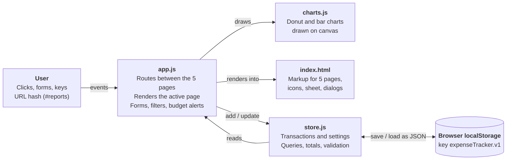

# ExpenseTracker — Project Documentation

Last updated: 16 October 2026

## Contents

1. [Overview](#overview)
2. [Features](#features)
3. [Getting started](#getting-started)
4. [User guide](#user-guide)
5. [Architecture](#architecture)
6. [Data model and storage](#data-model-and-storage)
7. [Design system](#design-system)
8. [Validation, accessibility and testing](#validation-accessibility-and-testing)
9. [Limitations and future work](#limitations-and-future-work)

## Overview

ExpenseTracker is a responsive web app that helps students record income and expenses, set a monthly budget and see where their money goes. It runs entirely in the browser with plain HTML, CSS and JavaScript: no framework, no build step and no server.

**Problem.** Students lose track of small daily spending (food, transport, mobile data) and reach the end of the month without knowing where their money went. Most finance apps are heavy, need an account, or are built for salaried adults.

**Solution.** A lightweight tracker that opens instantly, keeps data private on the device, and turns raw transactions into a balance, a budget warning and a clear breakdown by category.

| Item | Detail |
| --- | --- |
| Target users | University students and anyone tracking personal spending |
| Platforms | Any modern browser on desktop, tablet or phone |
| Languages | HTML5, CSS3, JavaScript (ES6+) |
| Libraries | None (charts are drawn on canvas by hand); Nunito font from Google Fonts |
| Storage | Browser `localStorage` |
| Source code | [github.com/Redwan002117/expensetracker](https://github.com/Redwan002117/expensetracker) |
| Code size | 5 code files, about 2,400 lines |

## Features

The app has five pages (Dashboard, Transactions, Reports, Budget, Settings) plus an add/edit sheet that opens from anywhere.

| Feature | What it does | Where |
| --- | --- | --- |
| Balance hero card | Shows this month's balance; turns amber at 80% of budget and dark slate when over | Dashboard |
| Quick stats | Income, expenses and daily average spending for the selected month | Dashboard |
| Recent transactions | Latest five entries; tap one to edit | Dashboard |
| Smart insight | Names the biggest category, compares with last month, suggests one action | Dashboard |
| Spending donut | Category split with the five largest slices and an "Others" slice | Dashboard |
| Month switcher | Moves Dashboard, Reports and Budget back and forward by month | Dashboard, Reports, Budget |
| Add / edit / delete | Type, amount, category, date and note, with validation | Sheet (any page) |
| Search and filters | Free-text search, type pills, category and month dropdowns | Transactions |
| Day grouping | Entries grouped by date with each day's net total | Transactions |
| Charts | Category donut and 6-month income vs expenses bar chart | Reports |
| Report stats | Income, expenses, savings rate, biggest single expense, top 5 categories | Reports |
| Monthly budget | One overall spending limit per month | Budget |
| Category limits | Optional limit per expense category with progress bars | Budget |
| Budget alerts | Pop-up warning at 80% and when a limit is exceeded | After saving an expense |
| CSV export | Downloads filtered or all transactions for Excel / Google Sheets | Transactions, Settings |
| Backup and restore | Saves and reloads all data as a `.json` file | Settings |
| Sample data | Loads three months of realistic student transactions | Settings |
| Profile and currency | Name for the greeting; currency ৳, $, €, £ or ₹ | Settings |
| Light / dark / system | Theme mode, remembered between visits | Settings, top bar |
| Colour themes | Rose, Lavender, Sage, Peach and Ocean accents | Settings |
| Responsive layout | Sidebar on desktop, floating glass navigation bar on phones | All pages |

## Getting started

Nothing needs installing: open `index.html` in a browser and the app runs.

**Run locally**

1. Download or clone the repository: `git clone https://github.com/Redwan002117/expensetracker.git`
2. Open `index.html` by double-clicking it, or serve the folder for a proper URL:
   - `npx serve .` (Node.js), or
   - `python -m http.server 8000`, then visit `http://localhost:8000`
3. Go to **Settings → Load sample data** to explore the app with three months of example transactions.

**Deploy to GitHub Pages**

1. Make sure the repository is public (**Settings → General → Danger Zone → Change visibility**). Free GitHub Pages needs a public repository.
2. Open **Settings → Pages**.
3. Under *Build and deployment*, choose **Deploy from a branch**, branch `main`, folder `/ (root)`, and save.
4. After about a minute the site is live at `https://redwan002117.github.io/ExpenseTracker/`.

To keep the repository private, deploy the folder to Netlify or Vercel instead; both host static sites from private repositories for free.

**Browser support.** Current Chrome, Edge, Firefox and Safari (desktop and mobile). The glass blur effect uses `backdrop-filter`; older browsers show a solid background instead. An internet connection is only needed once to load the Nunito font; without it the app falls back to the system font.

## User guide

Most tasks start from the **Add transaction** button: the round + in the phone navigation bar, the sidebar button on desktop, or the **N** key.

### Dashboard

The dashboard summarises one month at a time; use the arrows beside the month name to move between months.

- **Balance card**: income minus expenses for the month. With a budget set, it stays the theme colour below 80% of the budget, turns amber from 80%, and dark slate once you are over.
- **Stats row**: total income, total expenses, and daily average spending (expenses ÷ days elapsed in the month).
- **Recent transactions**: the five newest entries. Tap one to edit it.
- **Smart insight**: your largest spending category, the change from last month, and one practical tip.
- **Monthly budget** and **Where it went**: budget progress and the category donut.

### Adding and editing a transaction

1. Choose **Expense** or **Income** at the top of the sheet.
2. Type the amount.
3. Pick a category (expense and income have different lists).
4. Check the date: it defaults to today, or the 1st of the month you are viewing.
5. Optionally add a note such as "Lunch at canteen".
6. Press **Add transaction**. A confirmation appears, plus a budget warning if this expense crossed 80% or 100% of a limit.

To edit, tap any transaction, change the fields and press **Save changes**. **Delete** asks for confirmation first. Close the sheet with ✕, **Esc** or a tap outside it.

### Transactions

- Search matches notes, category names and amounts.
- **All / Expenses / Income** pills filter by type. The category list changes to match.
- The month dropdown defaults to the current month; choose **All months** for full history.
- The chips above the list show the count, money in and money out for the current filter.
- **Export CSV** downloads exactly the transactions you are looking at.

### Reports

For the selected month: income, expenses, savings rate ((income − expenses) ÷ income), the biggest single expense, a category donut with amounts and percentages, a bar chart of the six months ending in that month, and the top five categories.

### Budget

1. Enter a **Monthly limit** and press **Save budget**. Enter 0 or leave it blank to remove it.
2. Optionally enter **Category limits** (e.g. Food ৳2,500) and press **Save limits**.
3. Progress bars are blue below 80%, amber from 80%, and red when over.

Budgets apply to every month; the page shows progress for the month selected at the top.

### Settings

| Setting | Options |
| --- | --- |
| Your name | Used in the dashboard greeting ("Good evening, Maruf") |
| Currency | ৳ BDT, $ USD, € EUR, £ GBP, ₹ INR (changes the symbol only, no conversion) |
| Theme | Light, Dark, or System (follows the device) |
| Colour theme | Rose, Lavender, Sage, Peach, Ocean |
| Export CSV | All transactions |
| Download / Restore backup | Full data as `.json`; restoring replaces current data after confirmation |
| Load sample data | Replaces current data with three months of examples |
| Delete everything | Removes all transactions and budgets; keeps theme choices |

### Keyboard shortcuts

| Key | Action |
| --- | --- |
| N | Add a transaction (when not typing in a field) |
| Esc | Close the open sheet or dialog |
| Tab / Shift+Tab | Move between controls (focus is clearly outlined) |

## Architecture

The app is three plain JavaScript files loaded by one HTML page. `store.js` owns the data, `charts.js` draws, and `app.js` connects them to the page.



User actions reach `app.js`, which saves through `store.js` and then redraws the page from the stored data.

| File | Lines | Responsibility |
| --- | --- | --- |
| `index.html` | 430 | Page shell, the five page sections, icon sprite, add/edit sheet, confirm dialog, toast area, early theme script |
| `css/style.css` | 710 | Design tokens, light/dark and colour themes, layout, every component style |
| `js/store.js` | 290 | Categories, currencies, colour themes; load/save to `localStorage`; add, update, delete; totals and category breakdowns; backup, restore, sample data |
| `js/charts.js` | 160 | Donut and grouped bar charts drawn on `<canvas>`, sharp on high-DPI screens, colours read from CSS tokens |
| `js/app.js` | 810 | Hash routing, rendering of each page, add/edit sheet, filters, budgets and alerts, settings, CSV/JSON export, theme switching |

**How a change flows**

1. The user saves a transaction in the sheet. `app.js` validates the fields.
2. `app.js` records the budget usage before the change, then calls `Store.add()` or `Store.update()`.
3. `store.js` updates the list and writes the whole state to `localStorage`.
4. `app.js` compares budget usage before and after and shows an alert if 80% or 100% was crossed.
5. `render()` redraws the current page from `Store`; `charts.js` redraws any charts.

**Routing.** Each page has a URL hash (`#dashboard`, `#transactions`, `#reports`, `#budget`, `#settings`). On `hashchange` the app shows that section, hides the others, highlights its navigation link and renders it, so the browser back button works.

**Script loading.** Plain `<script>` tags in order (store → charts → app), not ES modules, so the app also works when opened straight from the file system.

## Data model and storage

All data lives in one JSON object saved in the browser's `localStorage` under the key `expenseTracker.v1`. It is read once on load and re-saved after every change.

```json
{
  "transactions": [
    { "id": "mfx3k2a9b1c", "type": "expense", "amount": 220,
      "category": "food", "date": "2026-10-04", "note": "Lunch at canteen" }
  ],
  "settings": {
    "name": "Maruf", "currency": "৳", "theme": "system", "accent": "rose",
    "budget": 9000, "categoryBudgets": { "food": 2500, "transport": 800 }
  }
}
```

**Transaction fields**

| Field | Type | Rule |
| --- | --- | --- |
| id | string | Generated from the timestamp plus random characters |
| type | string | `income` or `expense` |
| amount | number | Greater than 0, at most 1,000,000,000, rounded to 2 decimals |
| category | string | A category id from the lists below |
| date | string | `YYYY-MM-DD` |
| note | string | Optional, up to 120 characters |

**Settings fields**

| Field | Type | Default |
| --- | --- | --- |
| name | string, up to 30 characters | empty |
| currency | symbol | ৳ |
| theme | `light`, `dark` or `system` | `system` |
| accent | `rose`, `lavender`, `sage`, `peach` or `ocean` | `rose` |
| budget | number, 0 = no budget | 0 |
| categoryBudgets | object of category id → limit | empty |

**Categories**

| Type | Categories |
| --- | --- |
| Expense | Food, Transport, Education, Bills, Shopping, Entertainment, Health, Other |
| Income | Allowance, Salary, Part-time, Scholarship, Gift, Other |

**Loading safely.** On load, and when a backup is restored, every transaction is checked: entries with a wrong type, a non-positive amount or a malformed date are dropped; unknown settings fall back to defaults. If the stored data cannot be parsed, the app starts empty instead of crashing.

**Backup file.** *Download backup* saves the same object with three extra fields (`app`, `version`, `exportedAt`) as `expensetracker-backup-YYYY-MM-DD.json`.

**CSV export.** Columns are Date, Type, Category, Amount, Note. The file starts with a UTF-8 byte-order mark so Excel shows ৳ correctly. Values starting with `=`, `+`, `-` or `@` are prefixed with an apostrophe to block spreadsheet formula injection.

## Design system

The interface follows the "Soft & Cool Glassmorphic" design system: a cool off-white canvas, white rounded cards, rounded type, colour-tinted glows instead of grey shadows, and small press animations. The original system was written for Tailwind; here every rule is a plain CSS custom property in `css/style.css`.

**Colour roles**

| Token | Light value | Role |
| --- | --- | --- |
| `--canvas` | #f8fafc (tinted per theme) | Page background |
| `--card` | #ffffff | Cards, sheets, sidebar |
| `--recess` | #f1f5f9 | Inputs, pills, nested panels |
| `--glass` | white at 85% + 40px blur | Mobile top bar and bottom navigation |
| `--ink` / `--body` / `--muted` | #0f172a / #475569 / #94a3b8 | Headings / body text / micro-labels |
| `--brand` | Set by colour theme | Buttons, active navigation, hero card, links |
| `--rose` | #f43f5e | Expenses, over-budget and delete (same in every theme) |
| `--emerald` | #10b981 | Income and success |
| `--sky` | #0ea5e9 | Progress and filters |
| `--indigo` | #6366f1 | Smart insight and budget hero |
| `--amber` | #f59e0b | 80% budget warning |

**Colour themes.** Each theme sets `--brand`, a darker hover shade, light tints and a faint canvas tint. In dark mode the tints are generated from the brand's RGB value at 14–28% opacity, so every theme works in both modes.

| Theme | Brand colour | Light canvas |
| --- | --- | --- |
| Rose (default) | #f43f5e | #f8fafc |
| Lavender | #8b7cf6 | #f9f8fd |
| Sage | #5e9e82 | #f7faf8 |
| Peach | #ee8a62 | #fcf9f6 |
| Ocean | #5b8fd9 | #f7f9fc |

**Typography.** Nunito throughout. Hero numbers weight 900 at 2.4–3.5rem; page titles 900; buttons and inputs 700–800 at 14px; body 500; micro-labels 900 at 10–10.5px, uppercase, 0.1em letter spacing.

**Geometry.** Corner radius 2rem for hero cards, 2.5rem for sheets, 1.5rem for cards, 0.75–1rem for inputs, fully round pills for buttons. Desktop uses a 256px sidebar and a 12-column grid split 7 + 5; phones get a single column and a floating navigation bar at 92% width.

**Dark mode.** A second set of token values under `[data-theme="dark"]` and `prefers-color-scheme: dark`. A small inline script applies the saved mode and colour theme before the page paints, so there is no flash of the wrong colours.

**Motion.** Buttons scale to 95% when pressed, views fade up 8px, sheets slide up. All animation is turned off when the device asks for reduced motion.

## Validation, accessibility and testing

Every form checks its input before saving, and the app was tested end-to-end in headless Chromium on desktop and phone sizes with no script errors.

**Input validation**

| Field | Rule | Message shown |
| --- | --- | --- |
| Amount | Required, greater than 0, at most 1,000,000,000 | "Enter an amount greater than 0." |
| Category | One must be selected | "Pick a category." |
| Date | Valid calendar date | "Pick a valid date." |
| Note | Up to 120 characters | Input stops at the limit |
| Budget and limits | Empty, 0 or a positive number | "Enter a budget of 0 or more." |
| Backup file | Valid JSON with a `transactions` list | "That file isn't valid JSON." |

**Security.** Notes and other user text are HTML-escaped before display, so typing `<script>` in a note shows it as text. CSV cells are protected against formula injection. Nothing is sent over the network.

**Accessibility**

- Semantic landmarks (`aside`, `header`, `main`, `nav`) and `aria-current` on the active page link.
- Dialogs use `role="dialog"` / `alertdialog` with `aria-modal`; focus moves into them and returns afterwards.
- Category chips and colour swatches are radio groups with `aria-checked`.
- Toasts are announced through an `aria-live` region; icon-only buttons have `aria-label`s; charts have text labels.
- A visible focus ring on every control, and reduced-motion support.

**Test checklist and results**

| Test | Viewport | Result |
| --- | --- | --- |
| First load with no data shows empty states | 1366×900, 390×844 | Pass |
| Load sample data fills dashboard, charts, insight | Both | Pass |
| Submitting an empty form shows all three errors | Both | Pass |
| Adding a ৳5,000 expense updates totals and triggers over-budget alert | Both | Pass |
| Transactions, Reports, Budget, Settings render | Both | Pass |
| No horizontal scrolling on the phone layout | 390×844 | Pass |
| Dark mode via system setting | 390×844 | Pass |
| Each of the 5 colour themes applies | 1366×900 | Pass |
| Colour theme survives a page reload | 1366×900 | Pass |
| JavaScript errors in console during all of the above | Both | None |

Two bugs were found and fixed during testing: transaction titles and subtitles ran together on one line, and selecting a category threw an error after the chips re-rendered.

## Limitations and future work

The main limitation is that data lives in one browser on one device; everything else follows from having no server.

**Current limitations**

- Clearing browser data, or using private browsing, erases transactions unless a backup was downloaded.
- No sync between phone and laptop, and no user accounts.
- Changing currency only changes the symbol; amounts are not converted.
- Budgets are the same every month; there is no per-month budget history.
- `localStorage` holds about 5 MB, which is roughly 25,000 transactions.

**Future improvements**

- User accounts and cloud sync (for example with Firebase or Supabase).
- Recurring transactions such as monthly rent or allowance.
- Shared budgets for roommates or groups.
- An installable Progressive Web App that works fully offline.
- Receipt photos attached to transactions.
- Yearly reports and PDF export.
